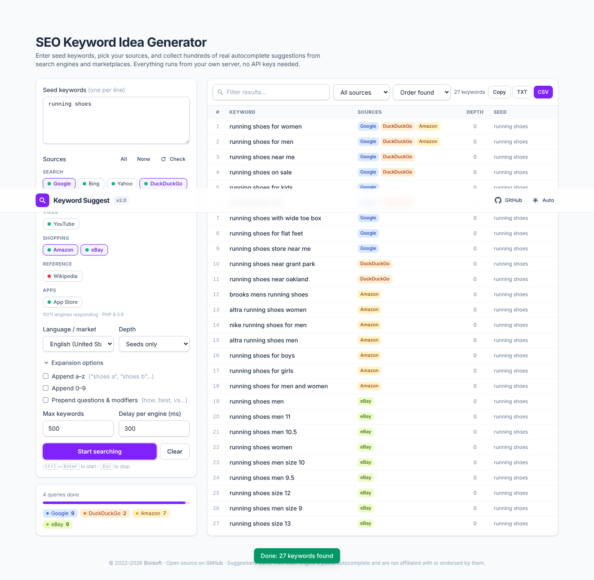

# Keyword Suggest Tool

A free, self-hosted keyword idea generator. Type a few seed keywords and it collects hundreds of real autocomplete suggestions from search engines, marketplaces and reference sites, merges and dedupes them, and lets you export the list as CSV (Excel) or plain text.



## Sources

| Group | Engines |
|---|---|
| Search | Google, Bing, Yahoo, DuckDuckGo, Qwant, Yandex |
| Video | YouTube |
| Shopping | Amazon (12 marketplaces), eBay (10 sites, also returns matching categories) |
| Reference | Wikipedia (per language) |
| Apps | Apple App Store |

All sources use each engine's public autocomplete endpoint. No API keys, no accounts. The requests are made server-side by a tiny PHP proxy, so the browser never depends on the engines supporting JSONP or CORS.

## Features

- Query any number of engines in parallel, each result tagged with the sources it came from
- Seed expansion: append a–z, 0–9, or prepend question/modifier words (how, best, vs, near me…)
- Follow suggestions of suggestions up to two levels deep, with a configurable result cap and per-engine delay
- Language / market selector (12 locales) that also picks the right Amazon and eBay marketplace
- Live filter, filter by source, sort by order found / A–Z / most sources / depth
- Copy to clipboard, download as CSV (UTF-8 with BOM, opens cleanly in Excel) or TXT
- Light / dark / auto theme, fully responsive, keyboard shortcuts (Ctrl+Enter start, Esc stop)
- Built-in engine status check so you can see at a glance which engines respond from your server
- Pre-fill seeds via `?keyword=running+shoes` in the URL

## WordPress and OpenCart plugins

The same engine ships as a **WordPress plugin** and an **OpenCart 4 extension**. Both add a keyword panel to the editor, propose seed keywords from the title and content you are writing, and let you click a suggestion to add it:

| | Seeds from | Click adds to |
|---|---|---|
| WordPress (`plugins/wordpress/keyword-suggest`) | post title + content | post / product tags, Yoast or Rank Math focus keyword, content at cursor, clipboard |
| OpenCart 4 (`plugins/opencart/keyword_suggest`) | product name, meta title, description | meta tag keywords, product tags, description at cursor, clipboard |

Download the zips from the [latest release](https://github.com/rmak78/keyword-suggest-tool/releases/latest):

- **WordPress**: Plugins > Add New > Upload Plugin > `keyword-suggest-wordpress-*.zip`. Settings under Settings > Keyword Suggest. The box appears below the editor (in the block editor, expand the **Meta Boxes** bar at the bottom).
- **OpenCart 4**: Extensions > Installer > Upload `keyword_suggest.ocmod.zip`, click Install, then Extensions > Extensions > Modules > Keyword Suggest > Install. The panel appears on the General tab of every product form.

To build the zips yourself: `npm run build:plugins` writes them to `build/`. Directory artwork and listing copy for wordpress.org and the OpenCart Marketplace are in `plugins/*/assets/` and [`docs/directory-submissions.md`](docs/directory-submissions.md). The shared PHP library (`public/api/lib.php`, `keyphrases.php`, `engines/`) is copied into each plugin at build time, so engine fixes land in all three products at once.

## Deploying the web tool to shared hosting (cPanel, Plesk, FastPanel…)

You need PHP 8.0+ with the `curl` extension, which every mainstream host ships.

1. Get a build. Either run `npm install && npm run build` locally, or open the **Actions** tab of this repository, pick the latest green run, and download the `keyword-suggest-tool-dist` artifact.
2. Upload the **contents** of the `dist/` folder to the web directory you want, for example `public_html/keyword-suggest/`.
3. Open the page. The sources panel runs a status check and shows a green dot for every engine that responds.

Nothing to configure. Responses are cached for an hour in the system temp directory to keep upstream traffic low.

## Development

```bash
npm install
npm run php     # PHP built-in server for the proxy on http://localhost:8080
npm run dev     # Vite dev server on http://localhost:5173, proxies /api to PHP
```

Other scripts:

```bash
npm test          # Vitest unit tests (crawler, dedupe store, CSV export) + PHP library tests
npm run build:plugins  # WordPress + OpenCart packages into build/
npm run build     # typecheck + production build into dist/
npm run lint:php  # php -l on every proxy file
```

To work on the UI without PHP, start Vite with mock data: `VITE_MOCK=1 npm run dev`.

Stack: TypeScript, Vite 7, Tailwind CSS 4, no runtime JS dependencies. The proxy is plain PHP.

## Project layout

```
plugins/
  wordpress/keyword-suggest/   WordPress plugin (meta box, AJAX, settings page)
  opencart/keyword_suggest/    OpenCart 4 extension (module, product form event, AJAX)
scripts/build-plugins.sh       copies the shared PHP library into both plugins and zips them
index.html              app shell
src/
  main.ts               wiring, preferences, health check
  engines.ts            engine registry (ids, labels, groups, chip colours, locales)
  crawler.ts            seed expansion, per-engine queues, depth/limit/stop
  store.ts              dedupe + source merging
  api.ts                fetch wrapper for the proxy (+ mock mode)
  export.ts             CSV / TXT / clipboard
  ui.ts, theme.ts       rendering and theming
public/api/
  suggest.php           GET ?engine=google&q=shoes&locale=en-US
  health.php            probes every engine once
  lib.php               curl helper, validation, caching, normalisation (namespace KeywordSuggest)
  keyphrases.php        seed keyword extraction from title + body text (used by the plugins)
  engines/*.php         one small adapter per engine (URL builder + parser)
tests/                  Vitest (TypeScript) and tests/php (shared PHP library)
```

## When an engine stops working

These endpoints are unofficial and change from time to time. Each one lives in its own file under `public/api/engines/`, about 20 lines: a URL builder and a parser. Fix the URL or the parser there, register nothing else, and the front end picks it up. Hit `api/health.php` to see the exact upstream error for each engine.

## Credits

Developed by [Bixisoft](https://bixisoft.com). Released under the license in `LICENSE.md`.

Suggestions come from each engine's public autocomplete and are not affiliated with or endorsed by those companies.
